<!-- ======================== HERO ======================== -->

 

### Engineering ideas into experiences.

Building full-stack applications, cloud-powered systems, and polished digital products.

 

  

---

## 👋 About Me

I'm Ansh — a full-stack developer interested in building complete digital products.

I work across frontend and backend engineering, database architecture, cloud infrastructure, Android development, and UI/UX.

I enjoy understanding how systems work under the hood, solving engineering problems, and turning ideas into functional applications.

I also leverage **AI-assisted workflows and effective prompting** to accelerate development, explore solutions, automate repetitive tasks, and improve productivity.

**My approach:** Understand the problem. Design the solution. Build it properly. Ship it.

---

## ⚡ Technical Skills

### 01 / FRONTEND DEVELOPMENT

  

### 02 / BACKEND & DATABASES

  

### 03 / CLOUD & DEVOPS

  

### 04 / ANDROID DEVELOPMENT

  

### 05 / DESIGN & AI-ASSISTED WORKFLOWS

 

### Engineering Capabilities

| Category          | Technologies & Skills                                          |
| :---------------- | :------------------------------------------------------------- |
| Frontend          | HTML5, CSS3, JavaScript, React, Tailwind CSS, TypeScript       |
| Backend           | Node.js, Express.js, REST APIs                                 |
| Database          | PostgreSQL, Prisma ORM, MongoDB                                |
| Cloud             | AWS, S3, Cloud Integration                                     |
| Android           | Kotlin, Jetpack Compose                                        |
| DevOps            | Git, GitHub, CI/CD Pipelines, Deployment                       |
| Real-time Systems | Socket.IO, WebSockets                                          |
| Security          | JWT Authentication, RBAC, Password Hashing                     |
| AI Productivity   | Effective Prompting, AI-Assisted Coding, Workflow Optimization |
| Design            | UI/UX, Responsive Design                                       |

---

## 🚀 Selected Projects

_Engineering work, not just technology demonstrations._

### 🟣 Organizly

**AI-Powered Collaborative Kanban Workspace**

A collaborative project management platform combining real-time communication with AI-assisted task planning.

- Built a full-stack application using React, TypeScript, Node.js, Express, Prisma, and PostgreSQL.
- Integrated Google Gemini for automated task breakdown and workload estimation.
- Implemented real-time collaboration and state synchronization using Socket.IO.
- Developed multi-tenant authorization with JWT and Role-Based Access Control.
- Optimized database queries through relational modeling and targeted B-tree indexing.

---

### 🔵 Zap

**Full-Stack Social Networking Platform**

A social networking application focused on real-time communication and seamless media sharing.

- Architected a full-stack social platform using React, Node.js, Express, Prisma, and PostgreSQL.
- Developed direct messaging, delivery receipts, and live activity notifications.
- Integrated AWS S3 pre-signed URLs for direct-to-cloud media uploads.
- Implemented automated asset lifecycle cleanup.
- Secured authentication and protected API endpoints using JWT and password hashing.

---

### 🟢 Hydrated Yet

**Android Hydration Tracker**

An Android application focused on making hydration tracking intuitive through custom visuals and interactive experiences.

- Developing with Kotlin and Jetpack Compose.
- Building custom water bottle visualizations and dynamic intake indicators.
- Designing animated onboarding and interactive components.
- Implementing reusable UI components, gradients, and a consistent design system.

---

## 🧠 Engineering Approach

| Principle           | Approach                                                      |
| :------------------ | :------------------------------------------------------------ |
| Problem Solving     | Understand the problem before choosing a solution.            |
| Architecture        | Build maintainable systems with clear separation of concerns. |
| User Experience     | Treat design and functionality as equally important.          |
| Efficiency          | Use automation and AI-assisted workflows to work smarter.     |
| Continuous Learning | Learn through experimentation and real-world projects.        |

---

## 🎓 Certifications & Professional Learning

| Certification                                  | Issuing Platform | Completion    |
| :--------------------------------------------- | :--------------- | :------------ |
| Meta Full Stack Developer Specialization       | Coursera         | March 2026    |
| Google UX Design Professional Certificate (v2) | Coursera         | November 2025 |
| Full Stack Developer Certification             | freeCodeCamp     | —             |

**Areas covered**

- **Meta:** HTML, CSS, JavaScript, React, Python, databases, Django, APIs and version control.
- **Google UX:** UX design professional training.
- **freeCodeCamp:** Full-stack development certification.

---

## 📊 GitHub Activity

  

---

## 🎧 Beyond the Code

- 🎵 Music & songwriting
- 💪 Calisthenics and fitness
- 🎨 UI/UX and visual design
- 🚀 Exploring ideas and building experimental products

---

<!-- ======================== FOOTER ======================== -->

  

Designed with curiosity. Built with intention.

